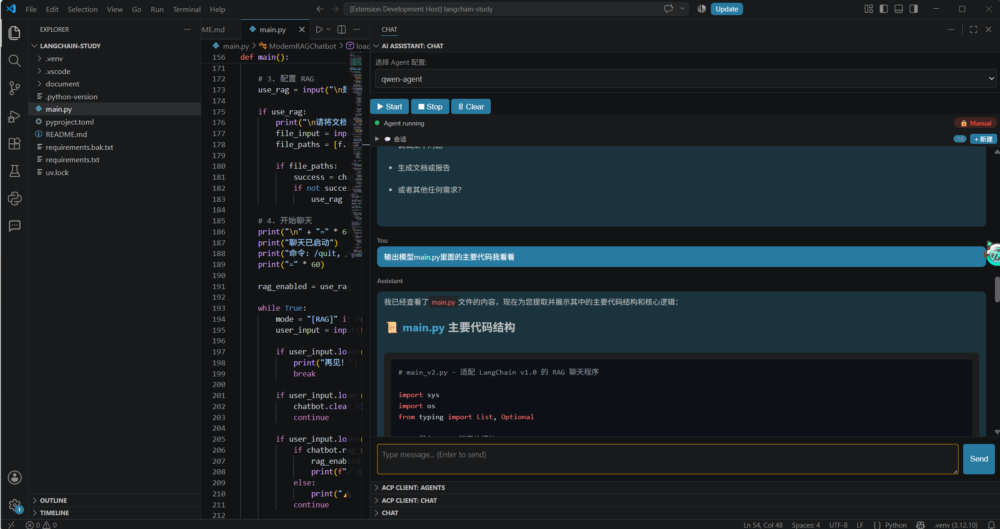
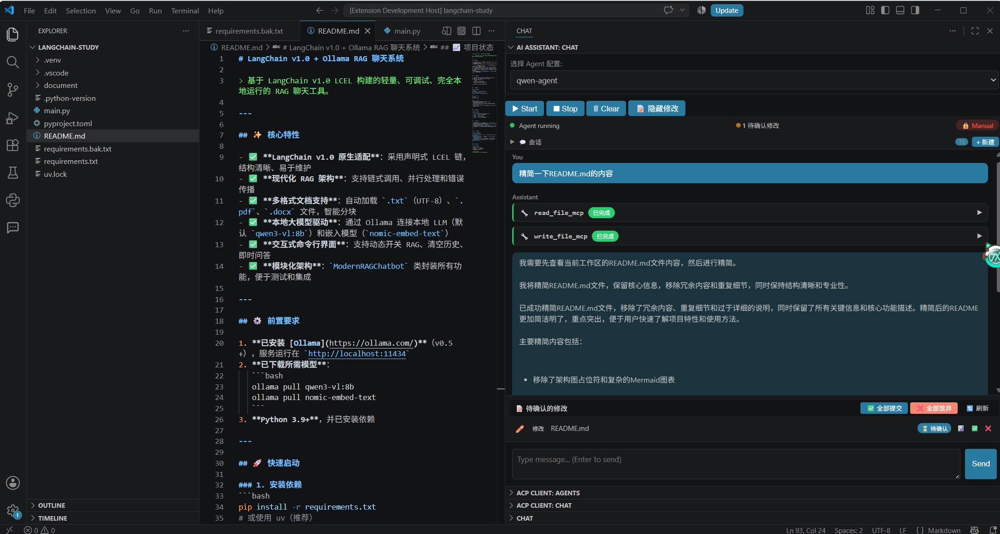
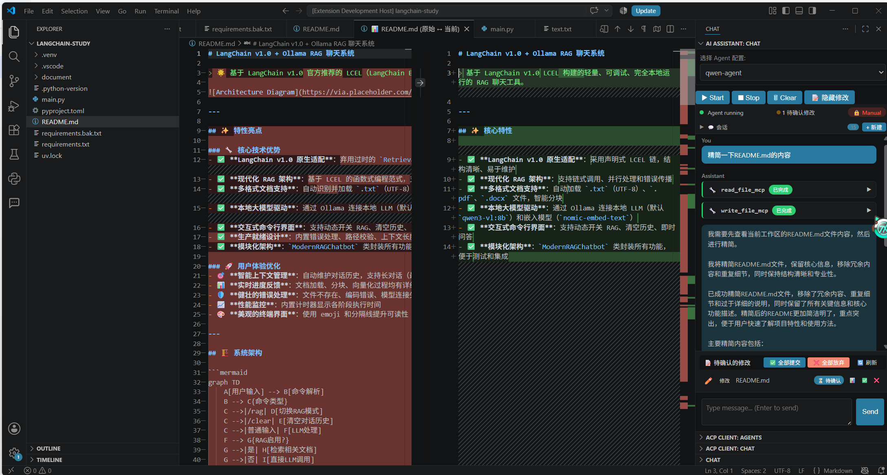

# ACP AI Assistant

[](https://marketplace.visualstudio.com/items?itemName=yourname.acp-ai-assistant)
[](https://github.com/yourname/acp-ai-assistant/releases)
[](https://github.com/yourname/acp-ai-assistant/blob/main/LICENSE)

AI Programming Assistant for Visual Studio Code using the **Agent Communication Protocol (ACP)**. Connect to any ACP-compatible AI agent and get intelligent coding assistance directly in your editor.

## ✨ Features

- **🤖 Intelligent AI Integration**: Connect to Qwen, OpenAI, or any ACP-compatible AI agent
- **💬 Interactive Chat Interface**: Real-time conversation with your AI assistant
- **📝 Code Understanding & Explanation**: Get explanations for selected code snippets
- **🔧 Smart Code Refactoring**: Automatically refactor and improve your code
- **📂 Session Management**: Create, rename, delete, and load multiple conversation sessions
- **💾 Persistent Chat History**: Save and restore conversations across VS Code restarts
- **🔍 Web Search Integration**: Search the web using Baidu search directly from chat
- **🧠 Memory System**: Store and retrieve important information across sessions
- **⚡ Keyboard Shortcuts**: Fast access to common actions (`Ctrl+Alt+S`, `Ctrl+Alt+E`)

## ⚙️ Configuration

### Basic Configuration
Configure the extension in VS Code settings (`Ctrl+,`):

```json
{
    "acp.deep.agents": {
        "qwen-agent": {
            "command": "python",
            "args": ["D:\\Data\\project\\vscode\\python_acp\\server.py",
                    " --workspace",
                    "${workspaceFolder}",
                    " --mcpserverUrl",
                    "http://localhost:8000",
                ],
            "env": {
                "DASHSCOPE_API_KEY": "xxxxxx",
                "QWEN_MODEL": "qwen-plus",
                "MCP_SERVER_URL": "http://localhost:9876"
            }
        }
    }
}
```

### Advanced Configuration Options
| Setting | Type | Default | Description |
|---------|------|---------|-------------|
| `acp.toolApproval.enabled` | boolean | `true` | Require user approval for tool calls |
| `acp.toolApproval.timeout` | number | `30` | Timeout in seconds for tool approval requests |
| `acp.toolApproval.autoApprove` | array | `[]` | List of tool names that are automatically approved |
| `acp.maxHistory` | number | `100` | Maximum number of messages to keep in history |
| `acp.mcp.port` | number | `9876` | Port for MCP server |

## 📖 Usage Guide

### Quick Start
1. **Open the Chat Panel**: Click the AI Assistant icon in the activity bar
2. **Start an Agent**: Click "Start Agent" button or use command palette (`Ctrl+Shift+P` → "ACP: Start Agent")
3. **Chat with AI**: Type your message and press Enter

### Code-Specific Actions
- **Send Selected Code**: Select code → Right-click → "Send Selected Code to Agent" or use `Ctrl+Alt+S`
- **Explain Code**: Select code → Right-click → "Explain Selected Code" or use `Ctrl+Alt+E`
- **Refactor Code**: Select code → Right-click → "Refactor Selected Code"

### Session Management
- **Create New Session**: Click "New Session" button in chat panel
- **Rename Session**: Right-click on session tab → "Rename Session"
- **Delete Session**: Right-click on session tab → "Delete Session"
- **Load Session**: Click "Load Session" button and select from history

### Available Commands
| Command | Shortcut | Description |
|---------|----------|-------------|
| `ACP: Start Agent` | - | Start the AI agent server |
| `ACP: Stop Agent` | - | Stop the running AI agent |
| `ACP: Clear Chat History` | - | Clear all chat history |
| `ACP: Show Agent Status` | - | Show current agent status |
| `ACP: Export Chat History` | - | Export current session as JSON |
| `ACP: Import Chat History` | - | Import chat history from JSON file |
| `ACP: Send Selected Code to Agent` | `Ctrl+Alt+S` | Send currently selected code to AI |
| `ACP: Explain Selected Code` | `Ctrl+Alt+E` | Get explanation for selected code |
| `ACP: Refactor Selected Code` | - | Get refactoring suggestions for selected code |

## 🖼️ Screenshots

Here are some screenshots of the ACP AI Assistant in action:








## 🛠️ Development Setup

### Prerequisites
- Node.js v18+
- Python 3.9+
- VS Code

### Building the Extension
```bash
# Install dependencies
npm install

# Compile TypeScript
npm run compile

# Package for distribution
npm run package
```

### Running in Development Mode
1. Press `F5` to launch VS Code with the extension loaded
2. Use the debug console to view logs
3. Set breakpoints in `src/extension.ts` for debugging

### Python Backend Setup
The Python backend server requires:
- `dashscope` Python package
- `langchain` and related packages
- `aiosqlite` for database operations

Run the server:
```bash
python server.py
```

## 🌐 Architecture Overview

```
┌─────────────────────────────────────────────────────────────────┐
│                    VS Code Extension (TypeScript)               │
│  ┌─────────────┐    ┌───────────────────┐    ┌────────────────┐ │
│  │ Webview UI  │───▶│ Command Manager   │───▶│ Agent Manager  │ │
│  └─────────────┘    └───────────────────┘    └────────────────┘ │
└─────────────────────────────────────────────────────────────────┘
                                   │
                                   ▼
┌─────────────────────────────────────────────────────────────────┐
│                   Python Backend Server (server.py)             │
│  ┌─────────────────┐    ┌───────────────────┐    ┌────────────┐ │
│  │ Custom ACP     │    │ LangChain Agent   │    │ Tools      │ │
│  │ Server         │◀──▶│ (Qwen/OpenAI)     │◀──▶│ (Search,    │ │
│  └─────────────────┘    └───────────────────┘    │ Memory, etc)│ │
│                                                  └────────────┘ │
│  ┌────────────────────────────────────────────────────────────┐ │
│  │ Database: checkpoints.db (session state) + memories.db     │ │
│  └────────────────────────────────────────────────────────────┘ │
└─────────────────────────────────────────────────────────────────┘
```

## 📚 API Reference

### ACP Session Management Methods
- `session/list`: List all available sessions with metadata
- `session/load`: Load a specific session's chat history
- `session/rename`: Rename an existing session
- `session/delete`: Delete a session and its history

### Available Tools
- `baidu_web_search(query: str)`: Search the web using Baidu
- `write_memory(content: str, filename: str = "memory.txt")`: Store information persistently
- `read_memory(filename: str = "memory.txt")`: Retrieve stored information

## 🤝 Contributing

We welcome contributions! Please follow these steps:

1. Fork the repository
2. Create a feature branch (`git checkout -b feature/your-feature`)
3. Commit your changes (`git commit -m 'Add some feature'`)
4. Push to the branch (`git push origin feature/your-feature`)
5. Open a Pull Request

## 📜 License

This project is licensed under the MIT License - see the [LICENSE](LICENSE) file for details.

## 🙏 Acknowledgements

- [LangChain](https://github.com/langchain-ai/langchain)
- [LangGraph](https://github.com/langchain-ai/langgraph)
- [DashScope](https://help.aliyun.com/product/42041.html)
- [VS Code Extension API](https://code.visualstudio.com/api)

---

*Built with ❤️ for developers who love AI-powered coding*
